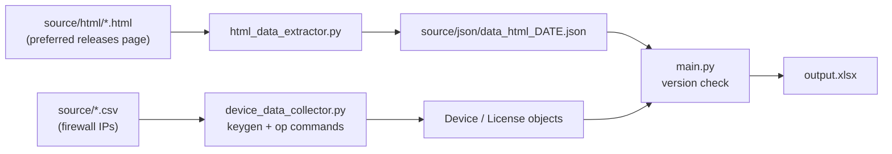

# palo-alto-stats-collector

<p>
  
  
</p>

> Collects model, PAN-OS version, content versions and licenses from a list of Palo Alto Networks firewalls through the PAN-OS XML API, compares each firewall's version with Palo Alto's preferred release and exports everything to Excel.

## Features

- Logs in to every firewall from a CSV with the XML API `keygen` call, then runs the operational commands you list (for example `show system info` and `request license info`).
- Credentials go in the POST body and the API key in the `X-PAN-KEY` header, so neither one ends up in a URL or a log line.
- TLS verification is on by default, with an optional CA bundle for firewalls signed by an internal CA.
- Parses the answers into `Device` and `License` objects (`models.py`), whether a firewall has one license or many.
- Reads the preferred PAN-OS releases from a saved copy of Palo Alto's support page and marks each firewall as up to date or not.
- Writes one Excel row per firewall, with its licenses as extra columns.

## How it works



`main.py` uses the newest JSON in `source/json/`. Only when that folder has no JSON does it build one from the newest HTML in `source/html/`, in a single attempt; if that fails, the run stops. To refresh the preferred versions, save a new copy of the page and delete the old JSON.

## Requirements

- Python 3.11+ (pandas 3 does not support 3.10).
- A firewall user allowed to use the XML API, the same on every device.
- HTTPS access from this machine to each firewall's management interface.

## Quickstart

### Install

```bash
git clone https://github.com/GDelpo/palo-alto-stats-collector.git
cd palo-alto-stats-collector
python -m venv env
source env/bin/activate          # Windows: .\env\Scripts\Activate.ps1
pip install -r requirements.txt
```

On Linux, `./setup_env.sh` does the same three steps.

### Configure

```bash
cp .env.example .env             # set USER_IP, PASSWORD_IP and URIS
mkdir -p source/html
```

- `source/devices.csv`: a CSV with an `ip` column, one firewall per row. Duplicates are skipped. The newest `.csv` in `source/` is used.
- `source/html/`: a saved copy (`.html`) of Palo Alto's preferred PAN-OS releases page. The extractor reads the tables between the `PAN-OS for Firewalls` and `Prisma Access for Panorama` headings.

`source/` is in `.gitignore`: it holds real device data.

### Run

```bash
python main.py                   # or ./run.sh, which uses env/bin/python3
```

The report lands in `output.xlsx` and the logs in `logs/proceso.log` and `logs/error.log`, all in the current folder.

## Configuration

| Variable | Description |
|----------|-------------|
| `USER_IP` | XML API user. |
| `PASSWORD_IP` | Password for that user. |
| `URIS` | PAN-OS operational commands in XML form, separated by `\|`. The parser reads the `system` and `licenses` results, so use `<show><system><info></info></system></show>\|<request><license><info></info></license></request>`. |
| `PANOS_CA_BUNDLE` | Optional. Path to a PEM CA bundle that signs the firewalls' certificates. |
| `PANOS_VERIFY_TLS` | Optional. `false` turns certificate verification off, for lab devices with self-signed certificates. Each request logs an error while it is off. |

The firewall IPs come from the CSV, not from `URIS`.

## Tests

```bash
pip install -r requirements-dev.txt
ruff check . && ruff format --check .
pytest
```

The tests use XML and HTML fixtures under `tests/fixtures/` and a fake `requests.post`, so they need no firewall. They cover where credentials and the API key travel, that they stay out of the logs, the TLS settings, error and non-XML answers, one versus several licenses, the HTML extraction, the single extraction attempt, the version check, CSV de-duplication and the Excel export. CI runs them on Python 3.11 and 3.14.

## Architecture

```
palo-alto-stats-collector/
├── main.py                  # entry point: preferred versions → devices → Excel
├── device_data_collector.py # XML API calls (keygen + operational commands)
├── html_data_extractor.py   # preferred releases page → JSON
├── dataframes.py            # CSV input and Excel export (pandas + openpyxl)
├── models.py                # Device, License
├── utils.py                 # source/ paths, newest-file lookup
├── logger.py                # file logging
├── setup_env.sh / run.sh    # Linux helpers
├── tests/                   # pytest suite + fixtures
├── requirements.txt         # runtime pins
└── requirements-dev.txt     # pytest + ruff
```

**Stack:** `requests` + `xmltodict` for the XML API, `beautifulsoup4` for the release page, `pandas` + `openpyxl` for the export.

## License

[MIT](LICENSE) © 2026 Guido Delponte
